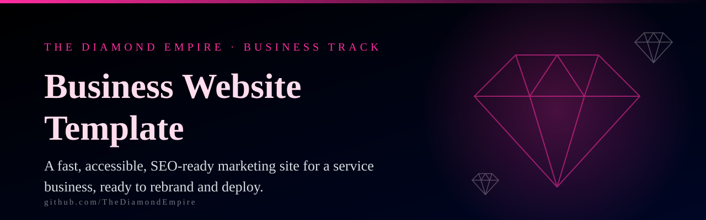
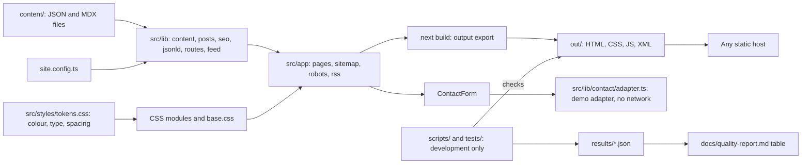

<p align="center"></p>

<p align="center">
  
  
  
</p>

# Business Website Template

> A fast, accessible, SEO-ready marketing site for a service business, ready to rebrand and deploy.

A complete multi-page website template for service businesses: home, services, pricing, about, blog, and contact. It is statically exported, themed through design tokens, accessible by construction, and ships with the SEO basics, so a small business can launch with its own brand in a day.

**Quick links:** [Architecture](#architecture) · [Tech stack](#tech-stack) · [Engineering decisions](#engineering-decisions) · [Quality report](docs/quality-report.md) · [Roadmap](#roadmap) · [Case study](docs/case-study.md)

> **Public showcase.** This repository holds the documentation, client case study, research report and measured results for this product. The runnable source code is distributed separately under a license: see [SOURCE-ACCESS.md](SOURCE-ACCESS.md).

## At a glance

|  |  |
|---|---|
| **Track** | Business · Advanced |
| **Phase** | Beta: all five milestones work, the tests pass from a clean short-path copy, and [docs/quality-report.md](docs/quality-report.md) records the results. Not Live: no customer has used it and no real form provider has been connected. |
| **Primary reader** | Clients and founders |
| **Read next** | [Quality report](docs/quality-report.md) · [Client case study](docs/case-study.md) |

## Why this exists

Small businesses either pay for a custom site or settle for a slow, inaccessible page-builder template with weak SEO. They need a clean foundation they can rebrand without becoming web developers.

## What it does (built and tested)

- **Pages (27 exported documents):** home, services, one page per service (generated from `content/services.json`, six samples), pricing, about, blog, five original MDX posts with nine tag pages, contact and a 404 page. All content is sample content for a made-up business, "The Diamond Empire Consulting".
- **Static export:** Next.js App Router with `output: 'export'` and `trailingSlash`, so every page is a folder with an `index.html` that any static host serves. No server is needed.
- **Design tokens and one config file:** colours, type scale, spacing and shape live in `src/styles/tokens.css`; names, address, contact details and navigation live in `site.config.ts`. A test fails if a hex colour, a font file or an external reference appears anywhere else in the styles.
- **Light and dark themes** from the same tokens: automatic through `prefers-color-scheme`, plus a toggle that remembers the choice on the device (local storage, no cookie). The dark values are written twice (media query and toggle) and a test fails if the copies differ.
- **Contact form:** client-side validation, an error summary that receives focus, inline errors linked with `aria-describedby`, and a provider-neutral submit adapter (`src/lib/contact/adapter.ts`). The default adapter makes **no network request** and shows a confirmation marked "Demo". An optional JSON adapter is included and unit-tested but not used. The form is disabled until its JavaScript has loaded, so a message cannot be sent as a plain page request.
- **SEO:** per-page title, description and canonical link from a configurable site address (`siteUrl` or `SITE_URL`), Open Graph and Twitter tags with a real 1200 x 630 PNG, `sitemap.xml`, `robots.txt`, an RSS feed, and JSON-LD for Organization, BlogPosting and BreadcrumbList. Scripts check that the sitemap, the feed and every canonical link agree with the exported pages.
- **Accessibility work that is tested:** landmarks, a skip link, keyboard operation with a visible focus ring, focus moved to the main area after a page change, native `details` for the FAQ, reduced motion respected, colour contrast computed from the tokens in both themes. Automated tools find only part of the problems that affect people, so this is **not** a claim of conformance with any accessibility standard; see the [quality report](docs/quality-report.md) for what was tested and what was not.
- **No tracking:** no analytics, no third-party requests, no web fonts, no CDN; system font stacks and generated SVG artwork only.
- **Budgets enforced by tests:** page weight, gzip size, JavaScript size and request count per page (see the quality report for the one budget that was revised after measuring), zero third-party requests, valid HTML, every link and anchor resolving.
- **Customer package:** `npm run package` builds a ZIP of the template source with its own `package.json`, guides and `START-HERE.md`; the measurement run extracts it, installs it, type-checks, lints, tests and builds it.

## Architecture



## Tech stack

| Layer | Technology used |
|---|---|
| Framework | Next.js 16.4.4 (App Router, static export, Turbopack build), React 19.3.1, TypeScript 5.9.3 |
| Styling | CSS custom properties and CSS modules; no runtime CSS-in-JS, no Tailwind |
| Content | JSON files and MDX posts (compiled at build time with `@mdx-js/mdx` 3.1.1 and `remark-gfm` 4.0.1; front matter read with `yaml` 2.9.1) |
| Artwork and type | Original inline SVG; system font stacks; one generated PNG for social sharing |
| Unit tests | Vitest 5.1.0, Testing Library, jsdom 30.1.3 |
| Lint and types | ESLint 9.39.5 with `eslint-config-next` (including accessibility rules for markup), `tsc` |
| Export checks | `html-validate` 11.18.0; `axe-core` 4.14.0 in the installed Chrome driven by `playwright-core` 1.64.1; scripts for contrast, links, metadata, sitemap and feed, weight, third parties |
| Packaging | `adm-zip` 0.6.1 builds a deterministic ZIP |
| Delivery | Static files; a GitHub Actions workflow that runs the same commands (it has not been run, see below) |

## Engineering decisions

### Static first

Every page is pre-rendered, so the site is cheap to host and has a small attack surface. The only dynamic need, the contact form, goes through one swappable adapter. The price of Next.js is its runtime: every page ships React and the Next.js client code, which is most of each page's weight (see the quality report).

### Links without prefetching

Internal links use the Next.js `Link` component with `prefetch={false}`, so loading a page requests exactly the files named in its HTML. A test fails if a link is added without it. Navigation still works client-side; focus moves to the main area after each change.

### No hamburger menu

The main navigation wraps onto a second line on narrow screens instead of hiding behind a button. It works without JavaScript, has no state to get wrong and was scanned at 320 px wide.

### Tokens, with the dark values written twice

CSS cannot share one block between `@media (prefers-color-scheme: dark)` and `[data-theme="dark"]`, so the dark values appear twice; a test fails if they differ. Every colour is a plain hex token so contrast can be computed from it.

### Honest forms

The default adapter is a stand-in that says so on screen. It cannot be mistaken for a working form.

### Accessibility is tested, not promised

Every exported page is scanned with axe-core in Chrome at 320, 768 and 1280 px in both themes, and keyboard and landmark behaviour are covered by scripted tests. These tests find only part of the problems that affect people; what they cannot cover is listed in the quality report.

### Rebranding is configuration

Brand values live in `src/styles/tokens.css` and `site.config.ts`; the guides show the few lines to change.

## Quality bar

Enforced by the commands in [Verification](#verification) and recorded in the [quality report](docs/quality-report.md):

- Clean install, type check, lint, unit tests and static build pass from a clean short-path copy
- html-validate on every exported page (recommended preset; five rules adjusted for framework output, disclosed in the report)
- Zero axe-core violations on every exported page in the tested variants (partial coverage, stated plainly)
- Per-page weight, gzip, JavaScript and request budgets, and no third-party requests
- Every internal link and anchor resolves; every page has a title, description, one h1 and (except the 404 page) a canonical URL

## Not built yet / out of scope

- **A real form provider connection.** The adapter ships as a stand-in on purpose; examples are documented, none was tested against a live service.
- **Screen reader, Firefox, Safari and real-device testing.** Only the installed Chrome was used.
- **Serving from a sub-folder** (`example.org/site/`). Use a domain or sub-domain.
- **Blog pagination, search, comments and a CMS.** Out of scope for a small-business template.
- **Multiple languages and right-to-left layouts.**
- **Photography.** The template uses generated SVG artwork and initials for people; there is no image pipeline.
- **Client results.** `docs/case-study.md` keeps its Results table blank: it is for measured engagements and none has happened.
- **The GitHub Actions workflow has not been run.** It runs the same commands as local development, but this repository was built and verified locally only.
- **Performance timings and Lighthouse runs.** Not measured: the machine was shared and loaded.

## Roadmap

- [x] M1: project skeleton, tokens, layout, navigation and the home page
- [x] M2: services, pricing and about pages with shared components
- [x] M3: blog with MDX, contact form and the submit adapter
- [x] M4: SEO layer (metadata, sitemap, structured data) and dark theme
- [x] M5: accessibility and budget tests, documentation and rebranding guide

## Getting started

> _These instructions refer to the source package, which is distributed separately and is not part of this showcase repository._

Requirements: Node 22 or later and Google Chrome or Microsoft Edge installed (the export checks drive the installed browser; nothing is downloaded). On Windows keep the project in a short folder path, because deep paths can break the tooling. From a clean checkout:

```text
npm ci
npm run check
npm run build
npm run serve
```

`npm run check` runs the type check, the lint and the unit and static tests. `npm run build` writes the site to `out/`; `npm run serve` shows it at http://127.0.0.1:3000. `npm run dev` starts the development server. To check the export in a browser and run the measurements:

```text
npm run test:export
npm run measure
npm run package
```

`npm run package` writes `dist/business-website-template-0.1.0.zip` for customers. The customer guides are in `docs/guide/` and are part of the ZIP.

## Verification

> _These instructions refer to the source package, which is distributed separately and is not part of this showcase repository._

| Command | What it checks |
|---|---|
| `npm run typecheck` and `npm run lint` | TypeScript and ESLint (Next.js, React hooks and accessibility rules) |
| `npm test` | unit tests (components, form, SEO helpers, content and post validation, feed and sitemap logic) and static tests (tokens and contrast from tokens, source rules, licences and notices, ZIP contents, documents) |
| `npm run test:export` | builds the site, then html-validate, links, metadata and structured data, sitemap, robots and feed consistency, weight budgets, third-party and tracking scans, and a real Chrome: page structure, requests, form behaviour, keyboard, theme, reduced motion, axe-core matrix |
| `npm run measure` | builds and runs every measurement once in one invocation, writes raw output to `results/` |
| `npm run report:table` | regenerates the results table in `docs/quality-report.md` from `results/` |
| `npm run test:record` | runs the whole suite once and records the counts in `results/test-run.json` |
| `npm run contrast`, `npm run licenses`, `npm run check:paths` | single checks on their own |

The final verification was run from a clean copy at a short path (`npm ci`, then the commands above) with its outputs written outside the copy; see the [quality report](docs/quality-report.md) for results and limits.

## Repository layout

> _These instructions refer to the source package, which is distributed separately and is not part of this showcase repository._

```text
site.config.ts        brand and site settings: the one config file
content/              JSON for pages, MDX for blog posts
public/               favicon, share image, third-party notices
src/app/              pages, sitemap, robots, RSS route
src/components/       header, footer, cards, form, SVG artwork (CSS modules)
src/lib/              content loaders, posts, SEO, JSON-LD, routes, feed, contact form logic
src/styles/           tokens.css (design tokens) and base.css
tests/unit/           Vitest unit and component tests (shipped to customers)
tests/static/         repository checks (tokens, source rules, documents)
tests/export/         checks on the built site and in a real browser
tests/budgets.json    page-weight budgets
scripts/              measure, package, contrast, licence, report and helper scripts
docs/guide/           customer guides (in the ZIP)
docs/quality-report.md  what was measured and what it means
docs/case-study.md    client case study (results table intentionally blank)
results/              raw measurement output and the generated summary
START-HERE.md         first page of the customer package
THIRD-PARTY.md        what is bundled and which dev tools are used
.github/workflows/ci.yml  CI definition (never run)
```

## Skills demonstrated

`Next.js and React` · `Accessible front-end engineering` · `Technical SEO` · `Design tokens and theming` · `Static-site architecture` · `Front-end testing`

## One project, three lenses

The same project is documented for three audiences, so one body of work serves every goal.

| If you are… | Read | You will find |
|---|---|---|
| Hiring or reviewing engineers | [This README](README.md) | Architecture, trade-offs, quality bar and what I would defend in a design review |
| A client or founder | [Client case study](docs/case-study.md) | The business problem, the value levers, how it is measured and how an engagement runs |
| A researcher or technical reviewer | Not applicable | This project is judged on its case study and its tests rather than an experimental study |

## Author

Built by **[The Diamond Empire](https://thedempire.shop/)**.
