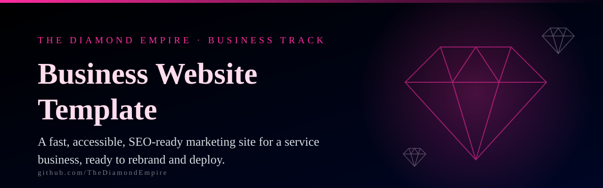

# Business Website Template: Client Case Study

> A professional, fast and accessible site live in days, on the business’s own brand.

> **Status of this document.** This is a reference case study: it sets out the business problem, the solution and the value model. The results table is intentionally blank and is filled in only from measured data (a pilot or a real engagement). No outcome figures are claimed here.

## Snapshot

|  |  |
|---|---|
| **Who it is for** | Small service businesses, consultants and agencies that want a professional site on their own brand without a custom build. |
| **Solution** | A fast, accessible, SEO-ready marketing site for a service business, ready to rebrand and deploy. |
| **Track** | Business · Advanced |
| **Delivered by** | The Diamond Empire |

## The challenge

A custom site is expensive and slow, and cheap templates are heavy, inaccessible and hard to change. The business ends up with a site that neither loads fast nor ranks.

## The solution

A complete multi-page website template for service businesses: home, services, pricing, about, blog, and contact. It is statically exported, themed through design tokens, accessible by construction, and ships with the SEO basics, so a small business can launch with its own brand in a day.

What the client gets in practice:

- Pages: home, services, service detail, pricing, about, blog with MDX posts, contact, and a 404
- Design tokens for color, type and spacing so a rebrand is a few lines, with light and dark themes
- Accessible components: keyboard navigation, visible focus, landmarks, skip link, reduced-motion support
- SEO built in: per-page metadata, Open Graph tags, sitemap, robots, canonical URLs and structured data
- Contact form with validation and a provider-neutral submit adapter (a stand-in that makes no network request is included)

## How it creates value

| Value lever | How the solution delivers it | How we measure it |
|---|---|---|
| Time to launch | A complete, tested starting point replaces a from-scratch build | Days from purchase to live site |
| Page speed and search visibility | Static pages, small bundles and built-in SEO | Core Web Vitals pass rate; organic impressions |
| Accessibility risk | Accessible components with automated checks | Accessibility issues found per page |
| Maintenance cost | Content in plain files and no server to run | Hours per month on site upkeep |

## How an engagement runs

| Phase | What happens |
|---|---|
| Brief | Brand, pages and content inventory |
| Brand | Tokens, logo and imagery |
| Build | Content and form integration |
| Launch | Checks, deploy and handoff |

## What the client receives

- Rebranded site on the client’s domain
- Content migrated into the template
- Contact-form provider connected
- Hosting and deployment set up
- Short editing guide

## Results

Baseline measurements are taken **before** the solution goes live, and the same measures are taken after, so every change in the table is attributable and honest.

| Measure | How measured | Baseline | After | Change |
|---|---|---|---|---|
| Time to launch | Days from purchase to live site | — | — | — |
| Page speed and search visibility | Core Web Vitals pass rate; organic impressions | — | — | — |
| Accessibility risk | Accessibility issues found per page | — | — | — |
| Maintenance cost | Hours per month on site upkeep | — | — | — |

> **To fill in:** replace each — with measured values and add the measurement window and sample size beneath the table.

## How quality and risk are managed

- Zero axe-core violations on every page at the tested viewport sizes (the automated check covers only part of WCAG; stated plainly)
- Page-weight and JavaScript budgets enforced in tests
- Every internal link and every page title, description and canonical URL verified by a script
- Clean install, type check, lint, unit tests and static build pass from a fresh checkout

## Is this a fit?

Best suited to: small service businesses, consultants and agencies that want a professional site on their own brand without a custom build.

## Talk to me

Want this adapted to your business? Get in touch via **[thedempire.shop](https://thedempire.shop/)**.

---

[README](../README.md) · [Client case study](case-study.md)
